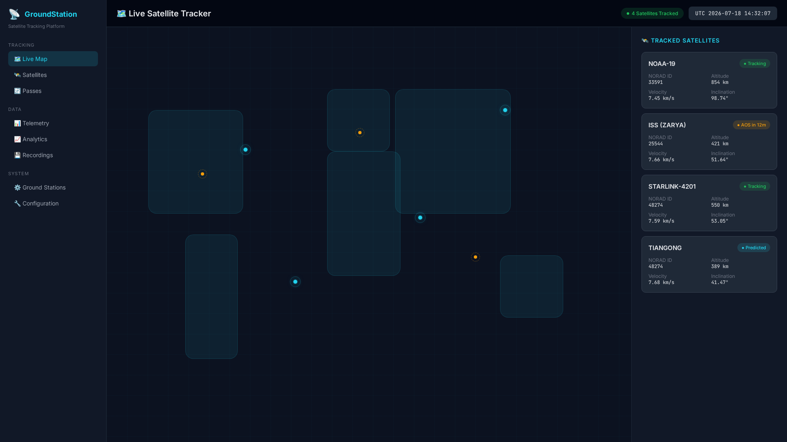
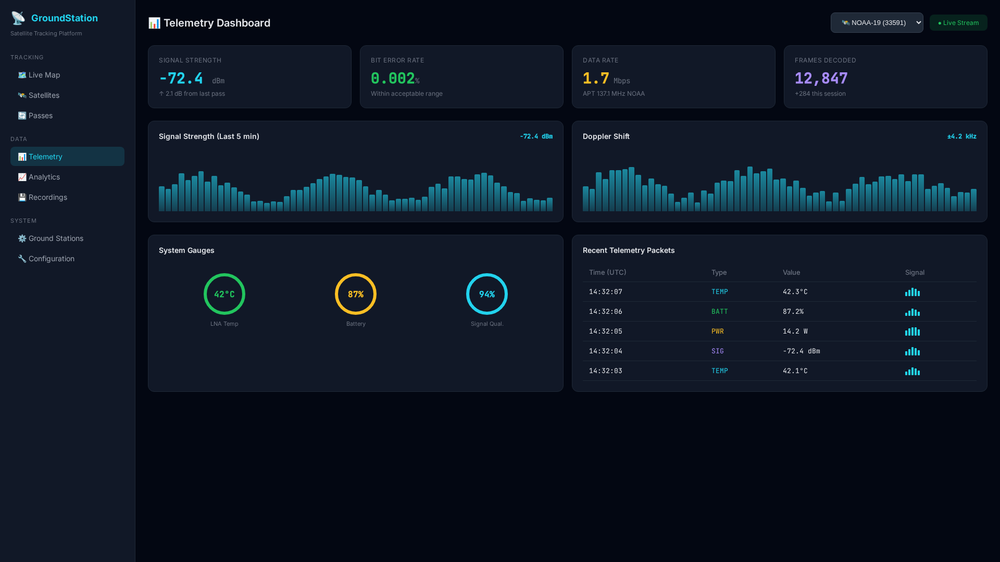
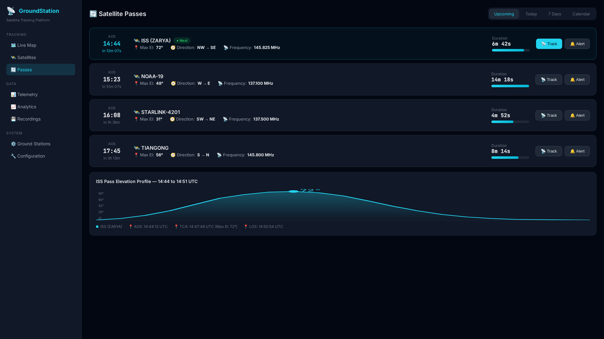

<div align="center">

  

  # 🛰️ GroundStation

  **All-in-One Satellite Monitoring Suite**

  Real-time satellite tracking, telemetry decoding, and ground station management

  [](https://opensource.org/licenses/MIT)
  [](https://www.python.org/)
  [](https://fastapi.tiangolo.com/)
  [](https://react.dev/)
  [](https://www.docker.com/)

  [Features](#-features) • [Quick Start](#-quick-start) • [Architecture](#-architecture) • [API](#-api-reference) • [Contributing](#-contributing)

</div>

---

## 📸 Screenshots

<div align="center">

| Satellite Tracker | Telemetry Dashboard | Pass Predictions |
|-------------------|---------------------|------------------|
|  |  |  |

</div>

> 💡 **Tip:** GroundStation supports over 2000 satellites including ISS, Hubble, and Starlink constellation

---

## ✨ Features

| Feature | Description |
|---------|-------------|
| 🛰️ **Satellite Tracking** | Real-time position and pass predictions |
| 📡 **Telemetry Decoding** | Decode satellite telemetry data |
| 🗺️ **Ground Station Map** | Visual ground station network |
| 📊 **Signal Analysis** | RF signal strength and quality metrics |
| 🔭 **Antenna Control** | Rotator and antenna position control |
| 📹 **Live Feeds** | Integration with SDR receivers |
| 🐳 **Docker Ready** | One-command deployment |
| 📱 **Web Dashboard** | Modern, responsive interface |

---

## 🚀 Quick Start

### Prerequisites

- Docker & Docker Compose
- Git
- SDR receiver (optional, for live data)

### Installation

```bash
# Clone the repository
git clone https://github.com/OneByJorah/GroundStation.git
cd GroundStation

# Start with Docker
docker compose up -d
```

### Access the Dashboard

Open **http://localhost:8080** in your browser

### Environment Variables

| Variable | Default | Description |
|----------|---------|-------------|
| `GS_PORT` | `8080` | Dashboard port |
| `TLE_SOURCE` | `celestrak` | TLE data source |
| `SDR_DEVICE` | - | SDR device path |

---

## 🏗️ Architecture

```
┌─────────────────────────────────────────────────────────────┐
│                     GroundStation                            │
├─────────────────────────────────────────────────────────────┤
│                                                             │
│   ┌──────────┐      ┌──────────┐      ┌──────────────┐    │
│   │ Browser  │ ───▶ │  Nginx   │ ───▶ │ FastAPI      │    │
│   └──────────┘      └──────────┘      └──────┬───────┘    │
│                                               │             │
│                                   ┌───────────┴──────────┐ │
│                                   │                      │ │
│                        ┌──────────┴──────────┐           │ │
│                        │                     │           │ │
│                        ▼                     ▼           │ │
│                 ┌──────────┐          ┌──────────┐      │ │
│                 │ Satellite│          │ Telemetry│      │ │
│                 │ Tracker  │          │ Decoder  │      │ │
│                 └──────────┘          └──────────┘      │ │
│                                                           │ │
│  ┌─────────────────────────────────────────────────────┐ │ │
│  │              Data Sources                           │ │ │
│  │  ┌─────────┐  ┌─────────┐  ┌─────────┐            │ │ │
│  │  │ Celestrak│  │  SDR    │  │  TLE    │            │ │ │
│  │  │  TLE    │  │Receiver │  │ Database│            │ │ │
│  │  └─────────┘  └─────────┘  └─────────┘            │ │ │
│  └─────────────────────────────────────────────────────┘ │
│                                                           │
└─────────────────────────────────────────────────────────────┘
```

### Tech Stack

| Component | Technology |
|-----------|------------|
| **Backend** | Python 3.10+, FastAPI, SQLAlchemy |
| **Frontend** | React 18, TypeScript, Leaflet.js |
| **Database** | PostgreSQL |
| **TLE Processing** | skyfield, sgp4 |
| **SDR Integration** | rtl-sdr, GNU Radio |
| **Deployment** | Docker Compose |

---

## 📁 Project Structure

```
GroundStation/
├── backend/                  # FastAPI backend
│   ├── main.py              # Application entry
│   ├── trackers/            # Satellite tracking
│   │   ├── sgp4.py          # SGP4 propagator
│   │   └── predictions.py   # Pass predictions
│   ├── telemetry/           # Telemetry decoding
│   │   ├── decoder.py       # Telemetry decoder
│   │   └── protocols/       # Satellite protocols
│   └── routers/             # API routes
├── frontend/                # React SPA
│   ├── src/
│   │   ├── components/      # UI components
│   │   ├── pages/           # Page components
│   │   └── hooks/           # Custom hooks
│   └── public/              # Static assets
├── sdr/                     # SDR integration
├── docs/                    # Documentation
│   └── screenshots/         # Dashboard screenshots
├── docker-compose.yml       # Docker deployment
└── requirements.txt         # Python dependencies
```

---

## 🔌 API Reference

### Satellites

| Endpoint | Method | Description |
|----------|--------|-------------|
| `/api/satellites` | `GET` | List all satellites |
| `/api/satellites/<norad_id>` | `GET` | Get satellite details |
| `/api/satellites/<norad_id>/position` | `GET` | Get current position |
| `/api/satellites/<norad_id>/passes` | `GET` | Get pass predictions |

### Telemetry

| Endpoint | Method | Description |
|----------|--------|-------------|
| `/api/telemetry/<norad_id>` | `GET` | Get telemetry data |
| `/api/telemetry/<norad_id>/latest` | `GET` | Get latest telemetry |

### Ground Stations

| Endpoint | Method | Description |
|----------|--------|-------------|
| `/api/stations` | `GET` | List ground stations |
| `/api/stations/<id>` | `GET` | Get station details |

### Example Usage

```bash
# Get ISS position
curl http://localhost:8080/api/satellites/25544/position

# Get pass predictions for ISS
curl http://localhost:8080/api/satellites/25544/passes?lat=40.7128&lon=-74.0060

# Get latest telemetry
curl http://localhost:8080/api/telemetry/25544/latest
```

---

## 🛠️ Development

### Local Development

```bash
# Clone the repository
git clone https://github.com/OneByJorah/GroundStation.git
cd GroundStation

# Backend setup
cd backend
python -m venv venv
source venv/bin/activate
pip install -r requirements.txt

# Start backend
uvicorn main:app --reload --host 0.0.0.0 --port 8000

# Frontend setup (new terminal)
cd ../frontend
npm install
npm run dev
```

### Running Tests

```bash
# Backend tests
cd backend
pytest

# Frontend tests
cd frontend
npm test
```

---

## 🤝 Contributing

Contributions are welcome! Please see [CONTRIBUTING.md](CONTRIBUTING.md) for guidelines.

---

## 📄 License

This project is licensed under the MIT License - see the [LICENSE](LICENSE) file for details.

---

## 🔒 Security

For security concerns, please see [SECURITY.md](SECURITY.md).

---

## 💬 Support

- 📧 Email: support@jorah.one
- 🐛 Issues: [GitHub Issues](https://github.com/OneByJorah/GroundStation/issues)
- 📖 Docs: [Documentation](docs/)

---

<div align="center">

  **Built with ❤️ by [Jhonattan L. Jimenez](https://github.com/OneByJorah)**

  [⬆ Back to Top](#-groundstation)

</div>
