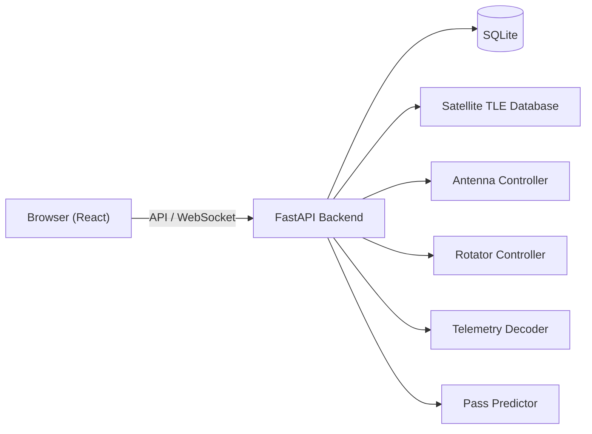

<div align="center">


# GroundStation

All-in-one satellite monitoring suite


</div>

---

<p align="center">
  
</p>

<br>

---

## Features

- **Real-Time Tracking** — Live satellite position and pass prediction.
- **Telemetry Decoding** — Decode and visualize satellite telemetry data.
- **Ground Station Control** — Manage antennas, rotators, and receivers.
- **Pass Prediction** — Predict upcoming satellite passes with alerts.
- **Multi-Satellite** — Track multiple satellites simultaneously.
- **Data Logging** — Record and export telemetry data.
- **React Dashboard** — Modern, responsive web interface.
- **FastAPI Backend** — Async Python backend with WebSocket updates.

## Quick Start

```bash
git clone https://github.com/OneByJorah/GroundStation.git
cd GroundStation

cp .env.example .env  # Configure your ground station
docker compose up -d --build
```

Open **[localhost:5003](http://localhost:5003)** in your browser.

### Local Development

```bash
cd backend
pip install -r requirements.txt
python app.py

# Frontend
cd frontend
npm install
npm run dev
```

## Environment Variables

| Variable | Default | Description |
|----------|---------|-------------|
| `HOST` | `0.0.0.0` | Interface the backend binds to |
| `PORT` | `5000` | Backend port (the container listens on `7000`) |
| `GS_ENVIRONMENT` | `development` | Runtime environment name |
| `DATABASE_URL` | `sqlite:///./data/groundstation.db` | Database connection string |
| `SDR_DEVICE_INDEX` | `0` | Index of the SDR device to open |
| `SDR_SAMPLE_RATE` | `2.4e6` | SDR sample rate in Hz |
| `SDR_CENTER_FREQ` | `100e6` | SDR center frequency in Hz |
| `SDR_GAIN` | `20` | SDR gain in dB |
| `DEEPGRAM_API_KEY` | — | Deepgram API key for transcription |
| `GEMINI_API_KEY` | — | Gemini API key for transcription |
| `STUN_SERVER` | `stun:stun.l.google.com:19302` | STUN server for WebRTC |
| `TURN_SERVER` | — | TURN server for WebRTC |
| `TURN_USERNAME` | — | TURN username |
| `TURN_CREDENTIAL` | — | TURN credential |
| `LOG_LEVEL` | `info` | Logging level |

## Architecture



## Tech Stack

- **Backend**: FastAPI (Python 3.10+), SQLAlchemy
- **Frontend**: React 18 (TypeScript)
- **Tracking**: SGP4/SDP4 orbit propagation
- **Telemetry**: Custom decoders for common protocols
- **Database**: SQLite (default), PostgreSQL (production)
- **Deployment**: Docker Compose

## Project Structure

```text
GroundStation/
├── backend/
│   ├── app.py               # Entrypoint: builds the ASGI app and runs uvicorn
│   ├── server/              # FastAPI app + routes (startup.py), lifespan, scheduler, versioning
│   ├── tracking/            # TLE handling, passes, Doppler, footprints
│   ├── telemetry/           # Telemetry decoding
│   ├── demodulators/        # Demodulation chains
│   ├── hardware/            # SDR and hardware access
│   ├── pipeline/            # Demodulation / decoding process orchestration
│   ├── observations/        # Observation scheduling and execution
│   ├── handlers/            # Socket.IO event handlers
│   ├── video/               # WebRTC routes
│   ├── db/                  # Database models and Alembic migrations
│   ├── data/                # Runtime data (database, recordings, snapshots)
│   └── tests/
├── frontend/
│   ├── src/
│   │   ├── components/      # React components
│   │   └── ...
│   ├── e2e/                 # Playwright end-to-end tests
│   └── package.json
├── .github/workflows/       # CI (tests, CodeQL, release)
├── docker-compose.yml       # Docker deployment
├── Dockerfile
└── .env.example             # Configuration template
```

## Supported Satellites

| Satellite | Frequency | Protocol |
|-----------|-----------|----------|
| ISS | 145.825 MHz | AFSK/9600 |
| NOAA 15/18/19 | 137.620 MHz | APT |
| Meteor-M2 | 137.900 MHz | LRPT |
| Custom | Configurable | Configurable |

## API Endpoints

| Endpoint | Method | Description |
|----------|--------|-------------|
| `/api/satellites` | GET | List tracked satellites |
| `/api/satellites/{id}/position` | GET | Get satellite position |
| `/api/passes` | GET | Upcoming pass predictions |
| `/api/telemetry` | GET | Recent telemetry data |
| `/api/antenna/status` | GET | Antenna status |
| `/api/rotator/status` | GET | Rotator status |

## Contributing

Contributions are welcome. Please see [CONTRIBUTING.md](CONTRIBUTING.md) for guidelines and [CODE_OF_CONDUCT.md](CODE_OF_CONDUCT.md) for community standards.

## Security

For security concerns, see [SECURITY.md](SECURITY.md). Please report vulnerabilities to `info@jorahone.com` — do not use public issues.

## License

MIT © Jhonattan L. Jimenez

---

<p align="center">Built with 🌴 by <a href="https://github.com/OneByJorah">OneByJorah</a> · <a href="https://jorahone.com">jorahone.com</a></p>
