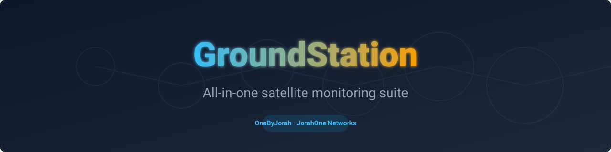
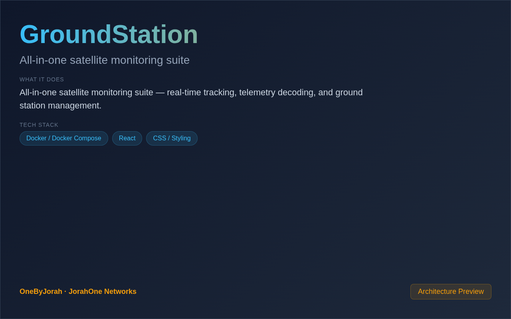

<div align="center">



# GroundStation

All-in-one satellite monitoring suite


</div>

---

<p align="center">
  
</p>

<br>

---

## Features

- **Real-Time Tracking** — Live satellite position and pass prediction.
- **Telemetry Decoding** — Decode and visualize satellite telemetry data.
- **Ground Station Control** — Manage antennas, rotators, and receivers.
- **Pass Prediction** — Predict upcoming satellite passes with alerts.
- **Multi-Satellite** — Track multiple satellites simultaneously.
- **Data Logging** — Record and export telemetry data.
- **React Dashboard** — Modern, responsive web interface.
- **FastAPI Backend** — Async Python backend with WebSocket updates.

## Quick Start

```bash
git clone https://github.com/OneByJorah/GroundStation.git
cd GroundStation

cp .env.example .env  # Configure your ground station
docker compose up -d
```

Open **http://localhost:8000** in your browser.

### Local Development

```bash
cd backend
pip install -r requirements.txt
uvicorn main:app --reload --port 8000

# Frontend
cd frontend
npm install
npm run dev
```

## Environment Variables

| Variable | Default | Description |
|----------|---------|-------------|
| `PORT` | `8000` | Backend API port |
| `DATABASE_URL` | `sqlite:///groundstation.db` | Database connection string |
| `TLE_UPDATE_INTERVAL` | `3600` | TLE data refresh interval (seconds) |
| `ANTENNA_HOST` | — | Antenna controller IP |
| `ROTATOR_HOST` | — | Rotator controller IP |

## Architecture

```
Browser (React) ──API/WebSocket──▶ FastAPI Backend ──▶ SQLite
                                        │
                                        ├──▶ Satellite TLE Database
                                        ├──▶ Antenna Controller
                                        ├──▶ Rotator Controller
                                        ├──▶ Telemetry Decoder
                                        └──▶ Pass Predictor
```

## Tech Stack

- **Backend**: FastAPI (Python 3.10+), SQLAlchemy
- **Frontend**: React 18 (TypeScript)
- **Tracking**: SGP4/SDP4 orbit propagation
- **Telemetry**: Custom decoders for common protocols
- **Database**: SQLite (default), PostgreSQL (production)
- **Deployment**: Docker Compose

## Project Structure

```
GroundStation/
├── backend/
│   ├── main.py              # FastAPI application
│   ├── services/
│   │   ├── satellite.py     # TLE and orbit calculations
│   │   ├── antenna.py       # Antenna control
│   │   ├── rotator.py       # Rotator control
│   │   ├── telemetry.py     # Telemetry decoding
│   │   └── predictor.py     # Pass prediction
│   ├── routers/             # API endpoints
│   └── models/              # Database models
├── frontend/
│   ├── src/
│   │   ├── components/      # React components
│   │   └── pages/           # Dashboard pages
│   └── package.json
├── docker-compose.yml       # Docker deployment
└── .env.example             # Configuration template
```

## Supported Satellites

| Satellite | Frequency | Protocol |
|-----------|-----------|----------|
| ISS | 145.825 MHz | AFSK/9600 |
| NOAA 15/18/19 | 137.620 MHz | APT |
| Meteor-M2 | 137.900 MHz | LRPT |
| Custom | Configurable | Configurable |

## API Endpoints

| Endpoint | Method | Description |
|----------|--------|-------------|
| `/api/satellites` | GET | List tracked satellites |
| `/api/satellites/{id}/position` | GET | Get satellite position |
| `/api/passes` | GET | Upcoming pass predictions |
| `/api/telemetry` | GET | Recent telemetry data |
| `/api/antenna/status` | GET | Antenna status |
| `/api/rotator/status` | GET | Rotator status |

## Contributing

Contributions are welcome. Please see [CONTRIBUTING.md](CONTRIBUTING.md) for guidelines and [CODE_OF_CONDUCT.md](CODE_OF_CONDUCT.md) for community standards.

## Security

For security concerns, see [SECURITY.md](SECURITY.md). Please report vulnerabilities to **info@jorahone.com** — do not use public issues.

## License

MIT © Jhonattan L. Jimenez

---

## 🤝 Contributing

See [CONTRIBUTING.md](CONTRIBUTING.md). All contributions follow the [Code of Conduct](CODE_OF_CONDUCT.md).

## 🔒 Security

Found a vulnerability? Please follow our [Security Policy](SECURITY.md) and report privately to `security@jorahone.com`.

## 📄 License

[GNU General Public License v3.0](LICENSE) © Jhonattan L. Jimenez (OneByJorah)

---

<p align="center">Built with 🌴 by <a href="https://github.com/OneByJorah">OneByJorah</a> · <a href="https://jorahone.com">jorahone.com</a></p>
